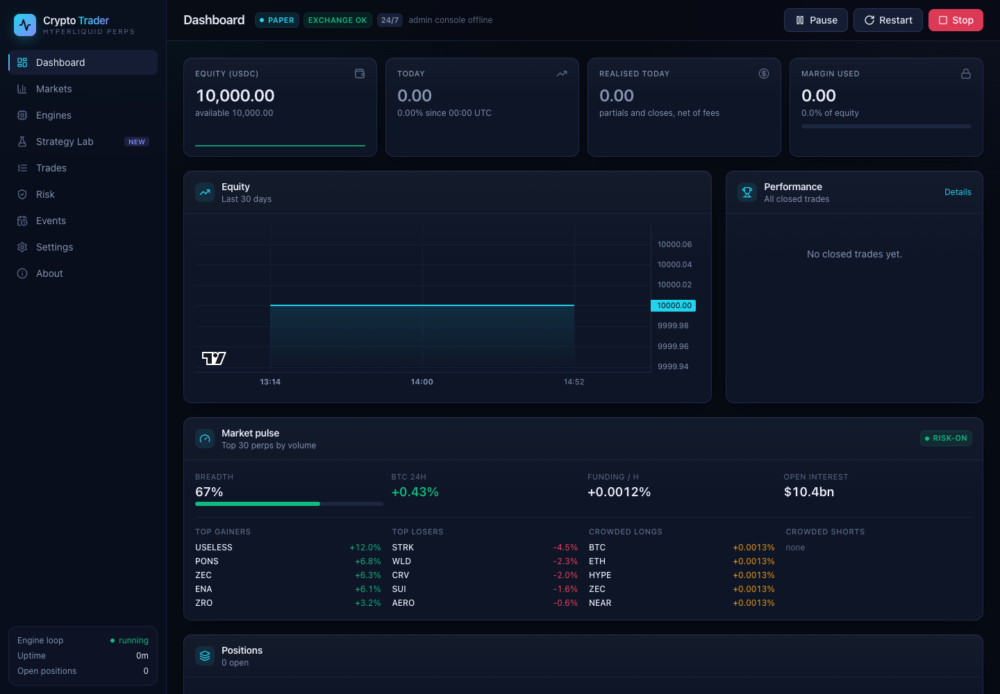
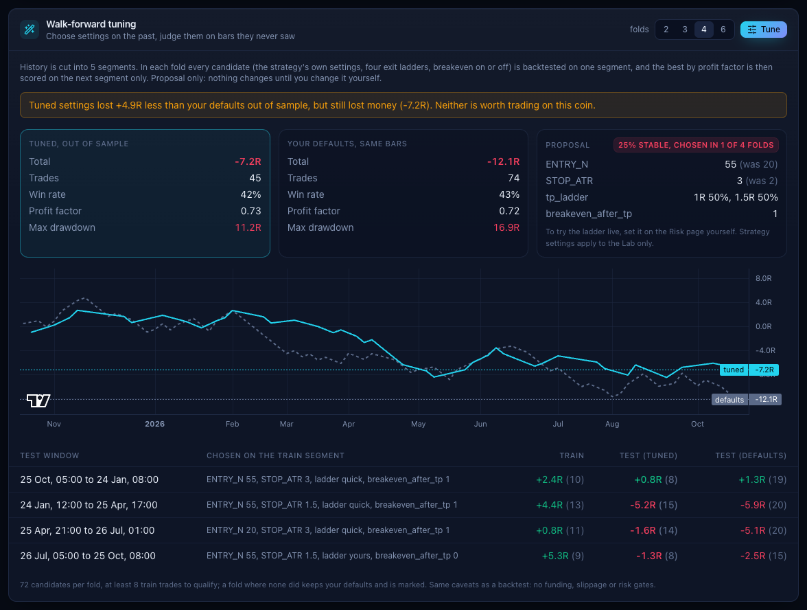
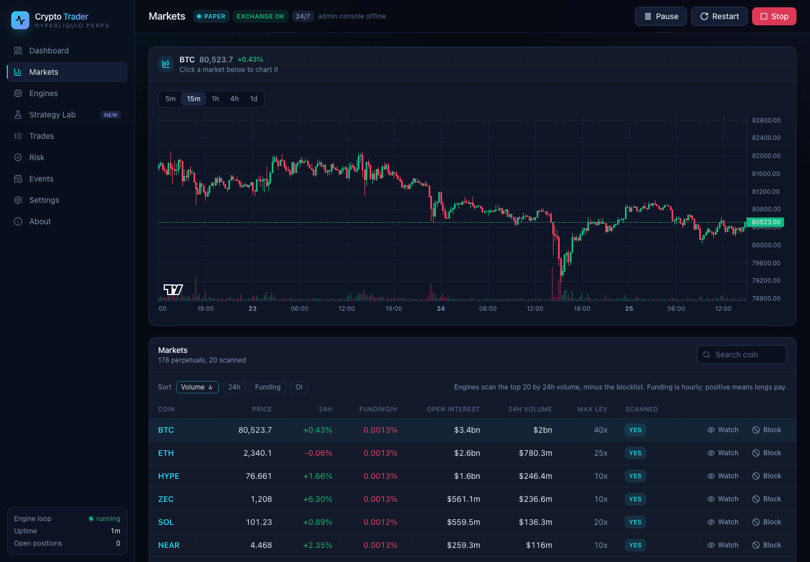
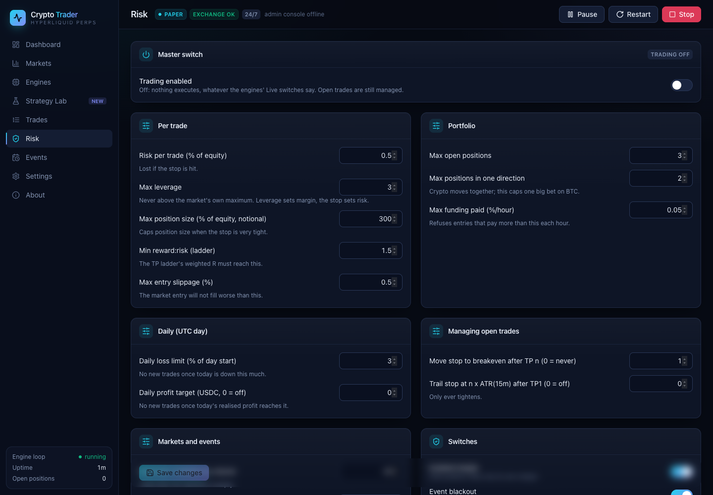
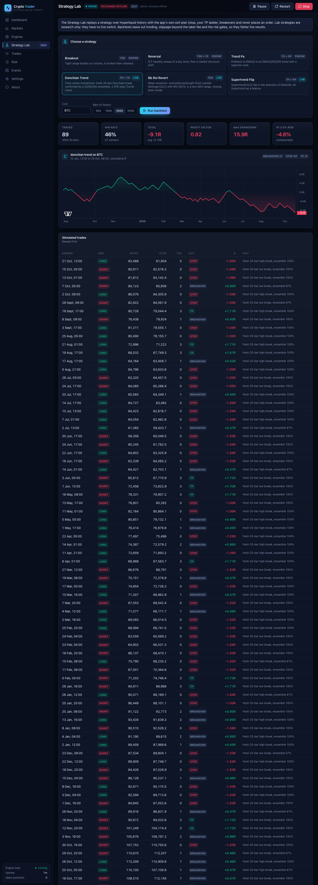
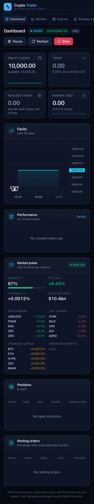

# Crypto Trader

Automated trading of **Hyperliquid perpetual futures**, 24 hours a day, 7 days
a week, from your own computer.

Three research engines watch the most liquid markets on Hyperliquid (or your
own watchlist), track every signal they find to its outcome, and learn which
ones work. When you switch an engine **live**, its signals go through a
deterministic risk governor and are traded with an **exchange-side stop-loss
and take-profit ladder**, so positions stay protected even when the app is
closed.

Sister project of [FOREX Trader](https://github.com/MooreSi/forex-gold) (XAUUSD
on MetaTrader 5), built from its rules and engines, and designed to run on the
same machine at the same time.

> **Version 0.2.** Starts in **paper** mode (simulated account on live prices,
> no wallet). Trading is **off** until you turn it on. Not financial advice.
> Leveraged crypto can lose money very quickly.



---

## What's new in 0.2

- **Strategy Lab**: backtest any engine, or three research strategies, on
  Hyperliquid history with the app's own exit plan. Read-only.
- **Walk-forward tuning**: settings are chosen on one stretch of history and
  scored only on the next, against your defaults on the same bars. It shows a
  proposal and never changes a setting by itself.
- **Performance analytics**, **market pulse**, **Telegram trade alerts**, ML
  feature insight and a redesigned dashboard. See the [changelog](CHANGELOG.md).

---

## Features

**Markets**
- Any perpetual listed on Hyperliquid. Scans the top 20 by 24h volume, or your
  watchlist; blocklist anything.
- Live price, funding, open interest and volume for every market; candle charts.

**Three engines, each with its own model**
| Engine | Timeframe | Looks for |
|---|---|---|
| Breakout | 15m | a tight range broken on volume, or broken and retested |
| Reversal (ICT) | 15m + daily | a liquidity sweep of a key level followed by a market structure shift (FVG / "unicorn" noted) |
| Trend PA | 1h + 4h | a pullback to EMA20 in an established EMA20/50/200 trend, with a rejection candle |

Every signal is tracked virtually through your real exit plan (TP ladder,
breakeven move, fees), and labelled a win only if it made money. Each engine retrains
daily on its own outcomes, and a new model is only accepted if it beats chance
on recent data it has never seen.

**Risk governor** (defaults in brackets)
- Risk per trade from the stop distance (0.5% of equity); positions rounded
  down to the exchange's lot size.
- Leverage cap (3x) and isolated margin, with liquidation kept well beyond the stop.
- Max open positions (3), max positions in one direction (2), funding-cost
  limit, daily loss limit (3%), optional daily profit target.
- Event blackout around high-impact events (30 min either side).
- Take-profit ladder (1R 50%, 2R 25%, 3R 25%), breakeven after TP1, optional ATR trailing.
- Every decision, placed or refused, is recorded with the reason.

**Strategy Lab** (backtesting, read-only)

| Strategy | Timeframe | Idea |
|---|---|---|
| Donchian trend | 4h + daily | time-series momentum: a fresh 20-bar breakout confirmed by a 20/55/100 channel ensemble, 2 ATR stop (Turtle rules) |
| Bollinger + RSI reversion | 15m | an oversold or overbought flush outside the bands, in a low-ADX range, closing back inside |
| Supertrend flip | 1h + 4h | a Supertrend(10,3) flip in the direction of EMA200 |

The three engines can be backtested too. A backtest walks history bar by bar
with no look-ahead, one trade per coin at a time, and scores trades in R with
your stop, take-profit ladder, breakeven rule and the taker fee. **Walk-forward
tuning** tries each strategy's settings, four exit ladders and breakeven on or
off: the best on one stretch of history is judged only on the next stretch,
and the result is set against your defaults on the same bars. Lab strategies
have no live switch.

> Honest numbers: on BTC (October 2026, 3000 bars each, no ML filter) every
> strategy, including the three engines, lost money in backtest (profit factor
> 0.37 to 0.82), and walk-forward tuning found nothing profitable out of
> sample. Backtests leave out funding, slippage and the risk gates. Do your own
> research on other coins before switching anything live.



**Analytics and market view**
- Performance: profit factor, expectancy in R, win rate, Sharpe (annualised),
  max drawdown, longest losing streak, average hold, per engine.
- Market pulse: breadth of the top 30 perps, volume-weighted funding, crowded
  longs and shorts by funding, top gainers and losers.
- Each engine shows its model's holdout AUC and the features it learned most from.

**Alerts**: optional Telegram messages for every open, take-profit, stop move
and close. The bot token is kept in your OS keychain.

**Crypto event calendar**: US macro releases (FOMC, CPI, NFP, PCE), Deribit
options expiries, the CME Bitcoin futures weekend gap, and your own token
unlocks, listings and upgrades, optionally tied to specific coins.

**Three networks**: `paper` (default), `testnet` (Hyperliquid's test exchange)
and `mainnet`.

**Dashboard** at `http://127.0.0.1:8890`: account, positions, resting orders,
equity curve, market pulse, markets with candle charts, engines, Strategy Lab,
trades with analytics and a full audit trail, risk settings, events, settings.
Works on a phone-sized screen too.

**Admin console**: reports to the shared FOREX Trader admin console, clearly
labelled **Crypto Trader**. Can be turned off in Settings.

## Screenshots

| Markets | Risk |
|---|---|
|  |  |

| Strategy Lab backtest | Phone |
|---|---|
|  |  |

## Install and run

Needs **Python 3.11+**. Runs locally only (no VPS mode in this build).

**macOS**: double-click `Crypto Start.command` (first run creates `.venv` and
installs everything). Stop with `Crypto Stop.command`.

**Windows**: double-click `Setup & Start Crypto.bat`. Stop with `Stop Crypto.bat`.

The dashboard header also has **Pause** (no new signals or trades; open
trades still managed), **Restart** and **Stop**. Stop and Restart shut the app
down cleanly; open positions keep their exchange-side stop and take-profits
while it is down.

**By hand**:

```bash
python3 -m venv .venv
.venv/bin/pip install -r requirements.txt
.venv/bin/python run.py
```

The dashboard opens at <http://127.0.0.1:8890>.

## Going from paper to real trading

1. Watch the **Engines** page in paper mode until an engine's tracked results
   show an edge, and check it in the **Strategy Lab** (backtest and
   walk-forward) on the coins you mean to trade. Paper does not charge funding or model liquidation, so it
   flatters live results.
2. In Hyperliquid, create an **API wallet** (More > API). It can trade but
   **cannot withdraw**. Never give this app your main wallet's private key.
3. **Settings**: enter your account address and the API wallet key (stored in
   your OS keychain), choose **testnet**, restart.
4. **Risk**: review every limit, then turn **Trading enabled** on; on
   **Engines**, switch one engine **Live**.
5. Only after testnet behaves as expected, repeat on **mainnet**.

## Running beside FOREX Trader

| | FOREX Trader | Crypto Trader |
|---|---|---|
| Dashboard | 8888 | **8890** |
| Data folder | `ForexTrader` | `CryptoTrader` |
| Lock, keychain, admin token | its own | its own |

Neither app's start or stop scripts can stop the other.

Data folder: `~/Library/Application Support/CryptoTrader` (macOS),
`%APPDATA%\CryptoTrader` (Windows), `~/.config/CryptoTrader` (Linux).

## For developers

Read [CLAUDE.md](CLAUDE.md) and [docs/system/rules/](docs/system/rules/00-start-here.md)
first. Everything is checked with one command:

```bash
.venv/bin/python -m tools.checks all     # tests, structural gates, coverage, boot
cd frontend && npm install && npm test && npm run build
```

Layout:

```
run.py                     start-up: lock, port check, server
backend/src/app.py         composition root
backend/src/runtime.py     24x7 loops: positions, engines, events, admin console
backend/src/api/           FastAPI routers (127.0.0.1 only, CSRF-protected)
backend/src/controllers/   one thin controller per page
backend/src/services/      exchange, market, engines, ml, risk, trading, positions, events,
                           remote, strategies (Lab), backtest (runner, tuning), notify (Telegram)
frontend/                  React dashboard (dist/ is committed)
tests/                     pytest suite (never touches an exchange)
tools/                     checks and structural gates
docs/system/               vision, rules, domain knowledge
```

## Licence

[GNU Affero General Public License v3.0](LICENSE), the same as FOREX Trader.
